# Gestor de Tareas

Aplicación web de gestión de tareas desarrollada con **React + Vite** para la asignatura *Herramientas de Software*. No tiene backend: todos los datos (usuarios, sesión y tareas) se guardan en el `localStorage` del navegador.

## Funcionalidades

- **Registro e inicio de sesión** con nombre, correo y contraseña.
  - La contraseña se guarda como hash **SHA-256** (Web Crypto API, `crypto.subtle`).
  - Validación de campos vacíos, formato de correo, longitud de contraseña y correo duplicado.
  - Sesión persistente y botón de **cerrar sesión**.
  - Cada usuario ve **solo sus propias tareas**.
- **Crear tareas** con título, descripción, fecha de vencimiento y prioridad (Baja, Media, Alta). Toda tarea nueva inicia en estado **Pendiente**.
- **Tablero de 3 columnas** por estado: *Pendiente*, *En progreso* y *Completada*.
  - La prioridad se distingue por color (verde, ámbar, rojo).
  - Las tareas **vencidas** (fecha pasada y no completadas) se resaltan en rojo.
- **Editar** tareas en una ventana modal y **eliminar** con confirmación.
- **Cambiar el estado** directamente desde la tarjeta y botón **✓ Completar**.
- **Búsqueda** por título o descripción y **filtros** por estado y prioridad, combinables entre sí.
- Diseño **responsive** (escritorio, tableta y móvil).

## Tecnologías

| Herramienta | Uso |
|---|---|
| React 18 | Componentes funcionales y hooks (`useState`, `useEffect`, `useContext`, `useMemo`, `useCallback`) |
| Vite 5 | Servidor de desarrollo y empaquetado |
| react-router-dom 6 | Rutas `/login`, `/registro` y `/tareas` (protegida) |
| localStorage | Persistencia de datos |
| Web Crypto API | Hash SHA-256 de contraseñas |

## Requisitos previos

- [Node.js](https://nodejs.org/) 18 o superior (incluye `npm`).

## Instalación y ejecución

```bash
# 1. Instalar dependencias
npm install

# 2. Ejecutar en modo desarrollo (http://localhost:5173)
npm run dev

# 3. Generar la versión de producción en /dist
npm run build

# 4. Previsualizar la versión de producción
npm run preview
```

> **Nota:** `crypto.subtle` solo funciona en contextos seguros (`https://` o `localhost`). Si se abre la app desde otra IP de la red local por `http`, el registro y el login no funcionarán.

## Estructura de carpetas

```
gestor-tareas/
├── index.html
├── package.json
├── vite.config.js
├── public/
│   └── favicon.svg
├── docs/
│   └── capturas/            # Capturas de pantalla (01-login.png ... 11-movil-nueva-tarea.png)
└── src/
    ├── main.jsx             # Punto de entrada: Router + proveedores de contexto
    ├── App.jsx              # Definición de rutas
    ├── index.css            # Estilos globales y responsive
    ├── components/
    │   ├── Navbar.jsx           # Barra superior con usuario y cerrar sesión
    │   ├── ProtectedRoute.jsx   # Redirige a /login si no hay sesión
    │   ├── TaskCard.jsx         # Tarjeta de tarea (prioridad, vencimiento, acciones)
    │   ├── TaskColumn.jsx       # Columna del tablero por estado
    │   ├── TaskForm.jsx         # Formulario de creación/edición con validaciones
    │   ├── Filters.jsx          # Búsqueda y filtros
    │   └── Modal.jsx            # Ventana modal reutilizable
    ├── pages/
    │   ├── Login.jsx
    │   ├── Register.jsx
    │   └── Tasks.jsx            # Tablero principal
    ├── context/
    │   ├── AuthContext.jsx      # Registro, login, logout y sesión
    │   └── TasksContext.jsx     # CRUD de tareas del usuario actual
    └── utils/
        ├── storage.js           # Lectura/escritura en localStorage
        ├── hash.js              # SHA-256 con crypto.subtle
        └── constants.js         # Estados, prioridades y utilidades de fechas
```

### Modelo de datos en localStorage

| Clave | Contenido |
|---|---|
| `gt_usuarios` | Arreglo de usuarios `{ id, nombre, correo, passwordHash, creadoEn }` |
| `gt_sesion` | Usuario con sesión activa `{ id, nombre, correo }` |
| `gt_tareas_<idUsuario>` | Tareas del usuario `{ id, titulo, descripcion, fechaVencimiento, prioridad, estado, creadaEn }` |

## Capturas de pantalla

### 1. Inicio de sesión
Formulario de acceso con validación de correo y contraseña.

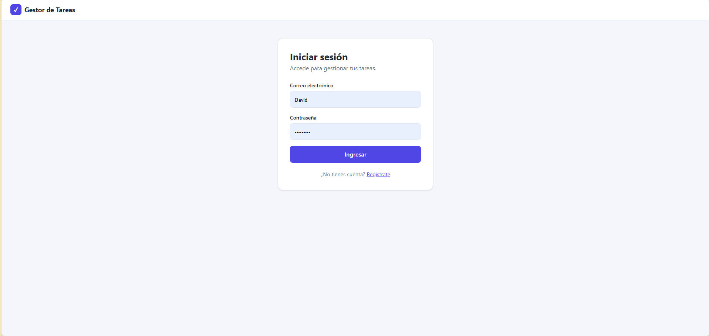

### 2. Registro
Creación de cuenta con nombre, correo, contraseña y confirmación.

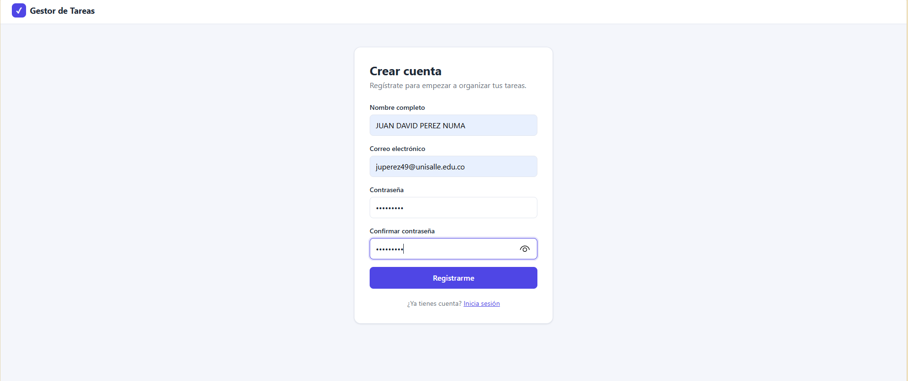

### 3. Tablero vacío
Vista inicial de un usuario nuevo: las tres columnas por estado sin tareas.

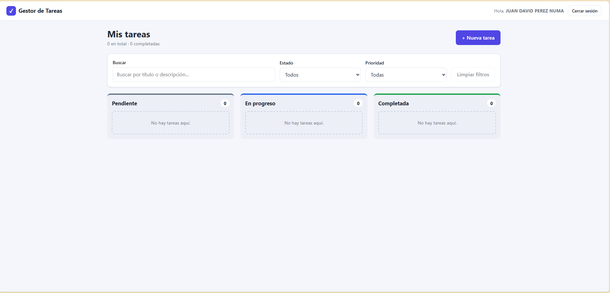

### 4. Tablero con tareas
Tareas organizadas en *Pendiente*, *En progreso* y *Completada*. Cada tarjeta muestra la prioridad con su color (rojo = Alta, ámbar = Media, verde = Baja), la fecha de vencimiento, el selector para cambiar de estado y los botones **Completar**, **Editar** y **Eliminar**. Las tareas completadas aparecen tachadas.

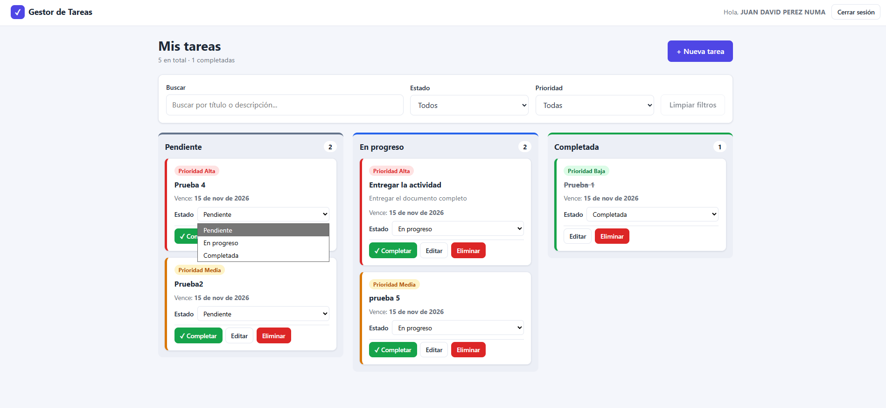

### 5. Filtro por estado
Al filtrar por un estado solo se muestra esa columna, junto con el número de coincidencias.

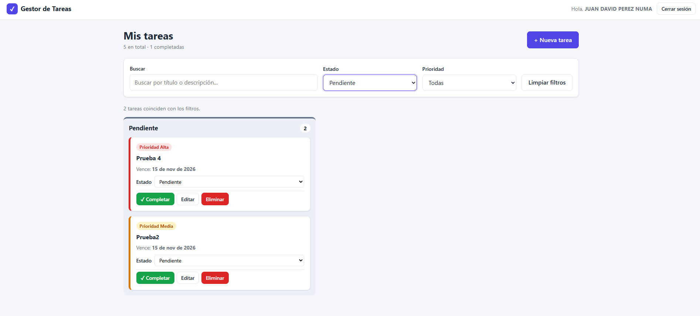

### 6. Filtro por prioridad
Filtrando por prioridad **Alta**: se mantienen las tres columnas, pero solo con las tareas que coinciden.

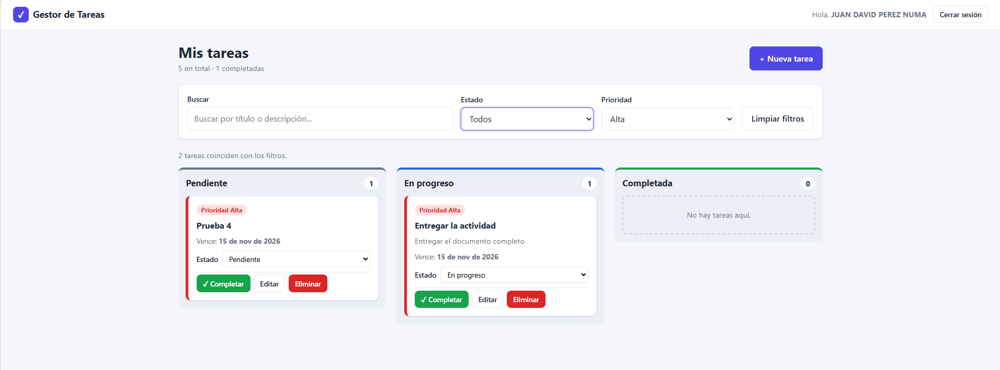

### 7. Búsqueda
Búsqueda en tiempo real por título o descripción. Se puede combinar con los filtros de estado y prioridad.

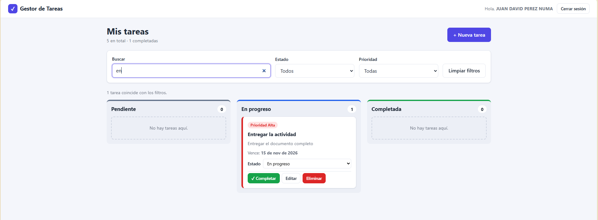

### 8. Edición de tarea
Modal de edición con los datos actuales de la tarea y sus validaciones.

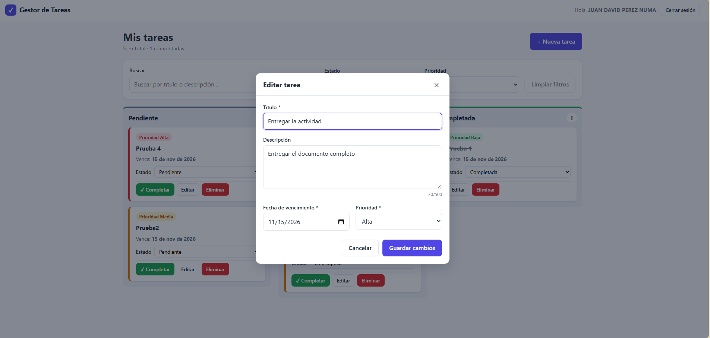

### 9. Vista móvil (responsive)
En pantallas pequeñas el diseño se adapta: el botón **Nueva tarea** y los filtros ocupan todo el ancho y se apilan, las columnas del tablero se muestran una debajo de otra, y en el modal los botones se apilan a lo ancho para tocarlos fácilmente.

<table>
  <tr>
    <th>Filtros</th>
    <th>Tablero</th>
    <th>Nueva tarea</th>
  </tr>
  <tr>
    <td>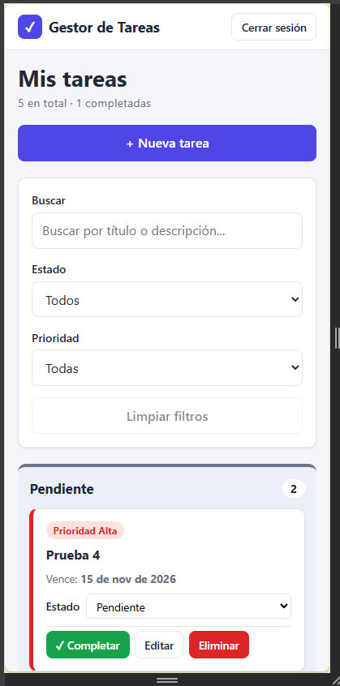</td>
    <td>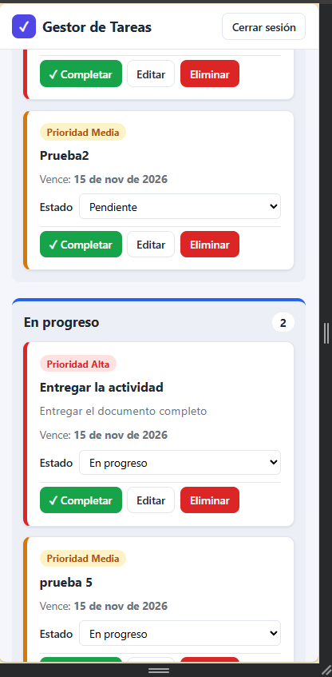</td>
    <td>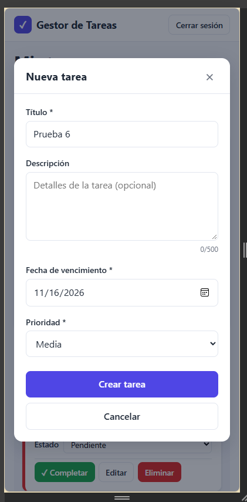</td>
  </tr>
</table>
